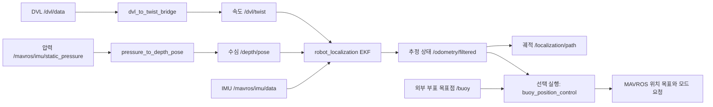

# AUV — Underwater Robot System Integration

**수중로봇의 센서, 위치 추정, Pixhawk 통신과 제어 인터페이스를 연결하는 ROS 2 패키지입니다.**

도플러 속도 센서(Doppler Velocity Log, DVL), 관성 측정 장치(Inertial Measurement Unit, IMU), 압력 기반 수심 데이터를 결합합니다. 확장 칼만 필터(Extended Kalman Filter, EKF)를 사용하는 `robot_localization`과 MAVROS를 중심으로 수중 운용 시스템을 구성했습니다.

Iwakuni Ocean Tech Days 2026 시니어 부문 3위 프로젝트의 시스템 통합 저장소입니다.

[팀 GitHub 조직](https://github.com/2026-kmu-underwater-robot)

## 주요 기능

- DVL 속도 메시지를 공분산이 포함된 표준 속도 메시지로 변환
- 압력 데이터를 상대 수심으로 변환하고 수직 방향 위치 입력 생성
- DVL 속도·IMU 자세 및 각속도·수심을 융합하는 3차원 위치 추정 설정
- 센서 유효성, 속도·가속도 한계, 수심 변화량을 이용한 이상값 배제
- 센서 입력 복구 시 연속 정상 샘플 확인과 공분산의 단계적 복원
- 조이스틱 명령을 MAVROS 제어 입력으로 변환하고 운용 모드 전환
- 외부에서 전달한 부표 목표점으로 이동 명령을 생성하고 도착 시 유지 모드 요청
- 위치 추정 궤적 기록, DroneCAN 배터리 정보 전달, 센서 좌표 변환 설정

## 위치 추정 구조



기본 필터는 DVL의 세 축 속도, IMU의 자세·각속도, 수심의 수직 위치를 사용합니다. 설정은 [config/auv_ekf.yaml](config/auv_ekf.yaml)에 있으며 출력 프레임은 `odom`, 로봇 기준 프레임은 `base_link`입니다.

## 저장소 구성

| 경로 | 역할 |
|---|---|
| [launch/rov_start.launch.py](launch/rov_start.launch.py) | 센서·MAVROS·좌표 변환·위치 추정·제어 노드 통합 실행 |
| [launch/localization_test.launch.py](launch/localization_test.launch.py) | 통합 실행 후 추정 궤적 발행 노드 추가 |
| [launch/mavros_auv.launch](launch/mavros_auv.launch) | MAVROS 연결 설정 |
| [config/auv_ekf.yaml](config/auv_ekf.yaml) | 융합 센서, 공분산, 프레임과 필터 주기 |
| [config/mavros_auv_pluginlists.yaml](config/mavros_auv_pluginlists.yaml) | 사용하는 MAVROS 플러그인 목록 |
| [src/dvl_to_twist_bridge.cpp](src/dvl_to_twist_bridge.cpp) | DVL 변환, 품질 검사와 복구 처리 |
| [src/pressure_to_depth_pose.cpp](src/pressure_to_depth_pose.cpp) | 압력·수심 변환과 수심 이상값 처리 |
| [src/buoy_position_control.cpp](src/buoy_position_control.cpp) | 목표점 변환, 위치 목표 발행, 도착 판단 |
| [src/joy2mavros.cpp](src/joy2mavros.cpp) | 조이스틱 입력 및 모드·시동 상태 전환 |
| [src/odom2mavros.cpp](src/odom2mavros.cpp) | ROVIO 오도메트리의 자세 변환 및 MAVROS 전달 |
| [src/localization_debug.cpp](src/localization_debug.cpp) | 추정 위치를 누적 궤적으로 발행 |
| [scripts](scripts) | 배터리 브리지, IMU 발행 주기 설정 등 |
| [include/auv](include/auv) · [test](test) | 센서 샘플 검사·공분산 복구 로직과 단위 테스트 |

## 의존성 및 빌드

ROS 2와 `ament_cmake`, `rclcpp`, `rclpy`, `geometry_msgs`, `sensor_msgs`, `nav_msgs`, `tf2`, `tf2_ros`, `tf2_geometry_msgs`, `mavros_msgs`, `robot_localization`이 필요합니다.

함께 준비해야 하는 외부 구성은 다음과 같습니다.

| 구성 | 용도 |
|---|---|
| `auv_dvl_a50_msg` | DVL 사용자 정의 메시지. 빌드 시 필요 |
| `auv_dvl_a50` | 실제 DVL 드라이버. 통합 launch에서 선택 실행 |
| MAVROS | Pixhawk 연결과 상태·명령 인터페이스 |
| Python `dronecan` 모듈 | 배터리 브리지 실행 |
| 조이스틱 드라이버 | `/joy` 발행. 이 패키지에서 드라이버 자체를 실행하지는 않음 |

ROS 2 환경을 불러온 터미널에서 진행합니다.

```bash
mkdir -p ~/ros2_ws/src
cd ~/ros2_ws/src
git clone https://github.com/2026-kmu-underwater-robot/auv.git

# auv_dvl_a50_msg와 필요한 DVL 드라이버도 작업공간에 준비
cd ~/ros2_ws
rosdep install --from-paths src --ignore-src -r -y
colcon build --packages-up-to auv --symlink-install
source install/setup.bash
```

사용자 정의 패키지는 `rosdep`만으로 설치되지 않을 수 있으므로 별도로 준비해야 합니다. MAVROS가 사용하는 GeographicLib 지오이드 데이터도 실행 환경에 있어야 합니다. launch 파일은 `egm96-5.pgm`을 찾거나 `GEOGRAPHICLIB_GEOID_PATH` 환경변수를 사용합니다.

## 실행

### 1. 통합 실행

```bash
ros2 launch auv rov_start.launch.py \
  fcu_url:=/dev/ttyACM0:57600 \
  dvl_ip:=192.168.194.95
```

위 장치 경로와 주소는 저장소의 기본값 예시이므로 실제 연결에 맞춰 지정합니다. DVL·IMU·수심 센서의 위치와 방향도 `base_to_fcu_*`, `dvl_*`, `depth_*`, `imu_*` 인자로 설정합니다.

통합 launch는 배터리 브리지도 실행합니다. 기본 인터페이스는 `can1`이며, 실행할 Python은 `dronecan_python`으로 지정할 수 있습니다. 기본적으로 `~/miniconda3/envs/auv_ros2/bin/python`이 있으면 사용하고, 없으면 `python3`를 사용하므로 해당 환경에서 ROS 2와 `dronecan`을 모두 불러올 수 있어야 합니다.

### 2. 위치 추정 궤적 확인

```bash
# 통합 실행을 포함하므로 위 명령과 동시에 중복 실행하지 않습니다.
ros2 launch auv localization_test.launch.py
```

기본 5초 뒤 `localization_debug`를 시작하고 `/localization/path`로 궤적을 발행합니다. RViz의 고정 프레임을 `odom`으로 지정해 확인할 수 있습니다.

```bash
ros2 topic hz /dvl/twist
ros2 topic hz /depth/pose
ros2 topic hz /odometry/filtered
ros2 topic echo /odometry/filtered --once
```

### 3. 부표 목표점 제어

통합 실행 시 `use_buoy_control:=true`를 지정하면 목표점 제어 노드를 함께 실행합니다. 기본값은 `false`입니다.

노드는 `/buoy`의 `geometry_msgs/msg/PointStamped`를 받아 `odom` 좌표계로 변환합니다. 목표가 있으면 `GUIDED` 모드를 요청하고, 도착 반경 안에 들어오면 `ALT_HOLD` 모드를 요청합니다. 기본 도착 반경은 0.10 m이며, 기본 설정에서는 목표점의 수직 위치를 사용하지 않습니다.

부표 검출·목표 좌표 생성은 외부 노드의 역할입니다. 이 저장소에는 영상 검출 모델이나 부표 검출 노드가 포함돼 있지 않습니다.

## 주요 토픽

| 방향 | 토픽 | 메시지 |
|---|---|---|
| 입력 | `/dvl/data` | `auv_dvl_a50_msg/msg/DVL` |
| 입력 | `/mavros/imu/data` | `sensor_msgs/msg/Imu` |
| 입력 | `/mavros/imu/static_pressure` | `sensor_msgs/msg/FluidPressure` |
| 입력 | `/joy` | `sensor_msgs/msg/Joy` |
| 입력 | `/buoy` | `geometry_msgs/msg/PointStamped` |
| 입력 | `/mavros/state` | `mavros_msgs/msg/State` |
| 출력 | `/dvl/twist` | `geometry_msgs/msg/TwistWithCovarianceStamped` |
| 출력 | `/depth/pose` | `geometry_msgs/msg/PoseWithCovarianceStamped` |
| 출력 | `/odometry/filtered` | `nav_msgs/msg/Odometry` |
| 출력 | `/localization/path` | `nav_msgs/msg/Path` (궤적 확인 launch에서 발행) |
| 출력 | `/mavros/rc/override` | `mavros_msgs/msg/OverrideRCIn` |
| 출력 | `/mavros/setpoint_raw/local` | `mavros_msgs/msg/PositionTarget` (부표 제어 활성화 시 발행) |
| 출력 | `/battery` | `sensor_msgs/msg/BatteryState` |

## 센서 품질과 복구 처리

**DVL 속도:** 유효 플래그, 유효 빔 수, 바닥과의 거리, 측정 품질, 공분산을 검사합니다. 속도와 가속도 한계를 넘는 샘플도 배제합니다. 입력이 복구되면 정상 샘플을 확인한 뒤 발행을 재개하고, 일시적으로 높인 공분산을 단계적으로 줄입니다.

**수심:** 압력을 Pa 단위로 받아 수심으로 변환합니다. 기본적으로 시작 시 수심을 기준값으로 잡고, 아래로 이동하면 `odom`의 수직 위치가 음수가 되도록 발행합니다. 급격한 수심 변화는 배제하고 정상 샘플이 연속으로 들어오면 복구합니다.

다음 값은 [통합 launch](launch/rov_start.launch.py)의 기본 설정이며, 운용 플랫폼에 맞춰 조정해야 합니다.

| 인자 | 기본값 | 의미 |
|---|---|---|
| `use_localization` | `true` | 센서 브리지와 EKF 실행 |
| `dvl_twist_max_velocity` | `0.65` | 허용 속도 크기, m/s |
| `dvl_twist_max_acceleration` | `1.5` | 허용 가속도, m/s² |
| `dvl_twist_reacquire_good_samples` | `2` | DVL 재수신 후 정상 샘플 확인 수 |
| `dvl_twist_recovery_variance_samples` | `15` | 복구 공분산 적용 샘플 수 |
| `pressure_input_mode` | `pressure_pa` | 압력 Pa 입력. `depth_m`이면 수심 값으로 해석 |
| `depth_gate_max_vertical_speed` | `1.2` | 수심 변화 검사에 사용하는 최대 수직 속도, m/s |
| `depth_gate_reacquire_good_samples` | `3` | 수심 입력 복구를 위한 정상 샘플 수 |
| `use_dvl_position_odom` | `false` | DVL 자체 위치를 별도 오도메트리로 발행 |
| `use_buoy_control` | `false` | 부표 목표점 제어 실행 |

필터 주기는 30 Hz, 센서 타임아웃은 0.3초로 설정돼 있습니다. DVL 자체 위치를 별도 발행하더라도 기본 EKF 설정은 `/dvl/odometry`를 융합하지 않습니다.

## 외부 위치 전달 시 확인할 점

현재 `odom2mavros`는 `/rovio/odometry`를 구독해 `/mavros/vision_pose/pose`로 전달하며, ROVIO의 센서 축을 로봇 기준 축으로 바꾸는 자세 회전을 적용합니다.

**기본 launch에는 `/odometry/filtered`를 이 노드로 연결하는 토픽 재매핑이 없습니다.** EKF 출력을 Pixhawk로 전달하려면 입력 토픽 연결뿐 아니라 자세 변환이 해당 입력에 맞는지도 확인해야 합니다. 이미 `base_link` 기준으로 추정한 자세에 ROVIO용 회전을 그대로 적용하면 좌표 기준이 달라집니다.

## 테스트

저장소에는 속도·수심 샘플 검사와 공분산 복구 로직의 단위 테스트가 포함돼 있습니다. ROS 2 빌드 환경에서 실행할 수 있습니다.

```bash
colcon test --packages-select auv
colcon test-result --verbose
```

검사 대상에는 급격한 속도 변화, 비정상 시간값, 수심 점프, 연속 정상 샘플을 통한 복구, 공분산의 단계적 복원 등이 포함됩니다.
